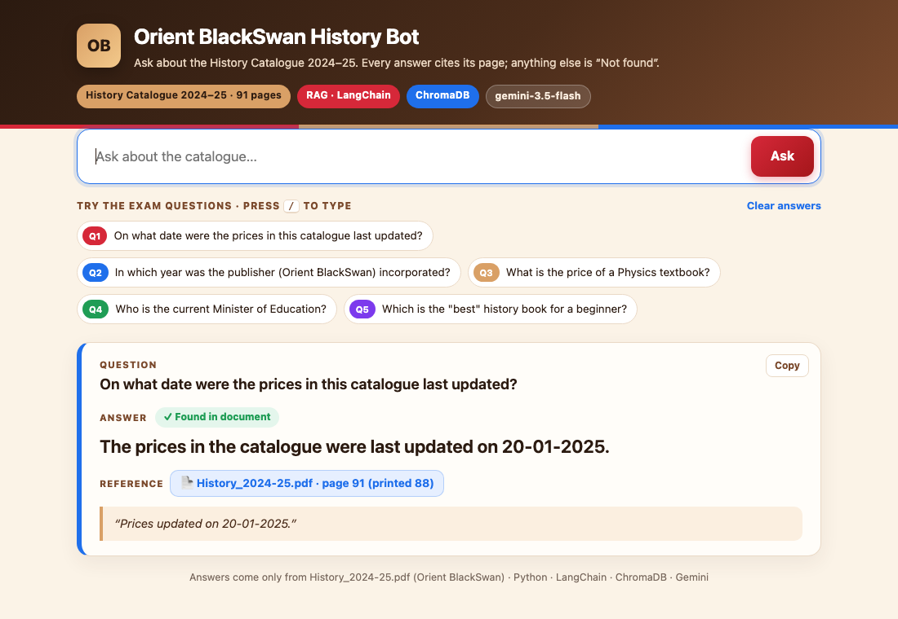
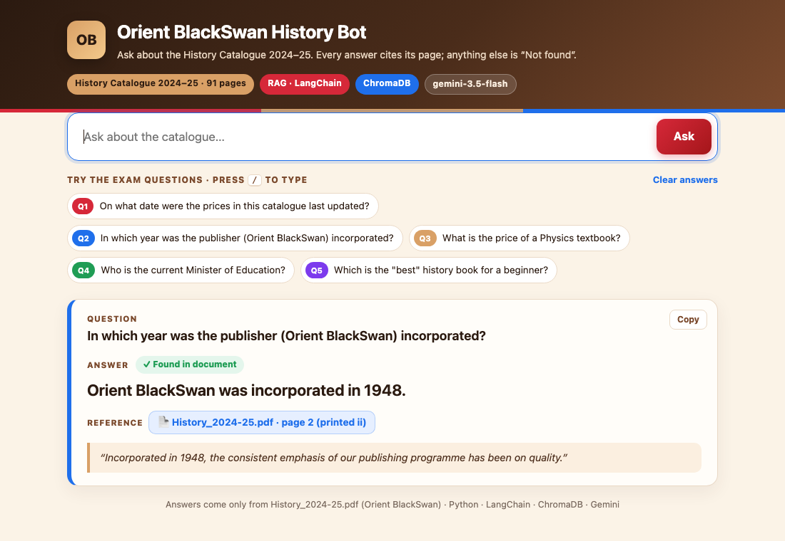
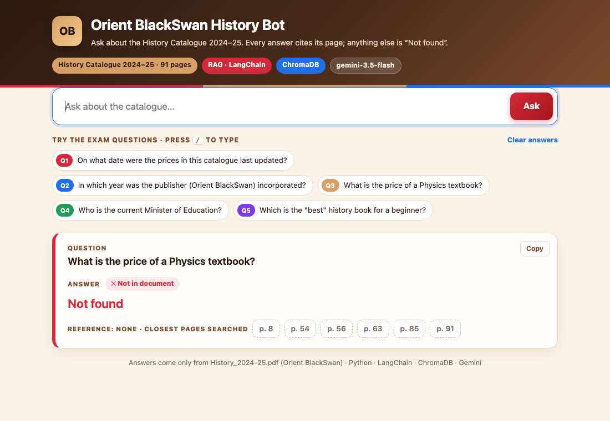
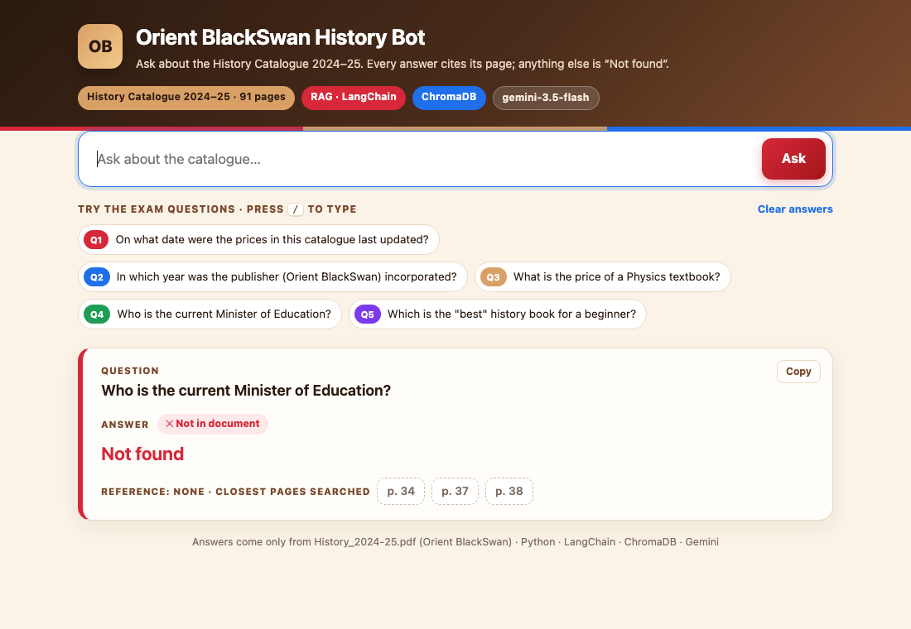
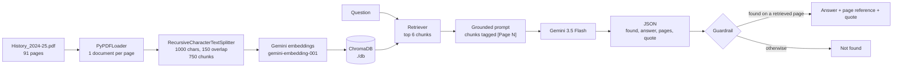

# 📚 Orient BlackSwan History Bot

A RAG chatbot (**Python + LangChain + ChromaDB + Gemini**) over the **Orient BlackSwan History Catalogue 2024–25**
(`History_2024-25.pdf`, 91 pages). Every answer comes with a **reference**: the page it was found on and a word-for-word
quote. If the answer is not in the catalogue, the bot replies **`Not found`**.

> Project 4 of the GenAI exam. It follows the structure of the reference repo [provks/GenAI](https://github.com/provks/GenAI):
> `rag/ingest.py` → `rag/ask.py` → a FastAPI website.

---

## ✅ Answers to the 5 questions

| # | Question | Bot's answer | Reference (where the answer is) |
|---|---|---|---|
| 1 | On what date were the prices in this catalogue last updated? | **20-01-2025** (20 January 2025) | `History_2024-25.pdf`, page 91 (printed page 88): *"Prices updated on 20-01-2025."* |
| 2 | In which year was the publisher (Orient BlackSwan) incorporated? | **1948** | `History_2024-25.pdf`, page 2 (printed page ii): *"Incorporated in 1948, the consistent emphasis of our publishing programme has been on quality."* |
| 3 | What is the price of a Physics textbook? | **Not found** | None. The catalogue lists history titles only; it has no physics textbook. |
| 4 | Who is the current Minister of Education? | **Not found** | None. No minister is named anywhere in the catalogue. |
| 5 | Which is the "best" history book for a beginner? | **Not found** | None. The catalogue describes books but never ranks them as "best" or for beginners. |

**Checked against the raw PDF text:**
- "Prices updated on 20-01-2025" is printed in the page footers (the bot cited page 91).
- "Incorporated in 1948" appears only on page 2.
- "Minister of Education" and "beginner" do not appear anywhere.
- "Physics" appears once, inside the description of *Atomic State: Big Science in Twentieth-Century India*, which is a history-of-science book, not a physics textbook.

---

## 📸 Screenshots (question asked + answer)

Each screenshot is the web UI (`server.py`) answering one exam question.

**Q1: On what date were the prices in this catalogue last updated?**



**Q2: In which year was the publisher (Orient BlackSwan) incorporated?**



**Q3: What is the price of a Physics textbook?**



**Q4: Who is the current Minister of Education?**



**Q5: Which is the "best" history book for a beginner?**


---

## 🔄 How it works (flow)



1. **Ingest** (`rag/ingest.py`, run once): `PyPDFLoader` reads the PDF page by page, so every chunk keeps its page number
   and printed page label. `RecursiveCharacterTextSplitter` cuts the pages into 1000-character chunks with 150 characters
   of overlap, roughly one or two catalogue entries per chunk. Each chunk is embedded with `gemini-embedding-001` and
   stored in a persistent **ChromaDB** collection in `./db`. Batches are throttled and retried, because the free tier
   rate-limits embeddings.
2. **Retrieve** (`rag/ask.py`): the question is embedded and the 6 most similar chunks are fetched from Chroma.
3. **Generate**: an LCEL chain `prompt | llm | JsonOutputParser()` sends the chunks to Gemini, each tagged `[Page N]`.
   The prompt says to use only the excerpts and no outside knowledge, to treat opinion questions ("best") as not
   answerable, and to reply with JSON: `found`, `answer`, `pages`, `quote`.
4. **Guardrail**: the bot replies exactly **`Not found`** if `found` is false, the answer is empty, or the cited page was
   not among the retrieved chunks. That last check stops made-up page references. When it does answer, the reply
   carries the page reference and the supporting quote. A `Not found` reply also lists the closest pages it searched.
5. **Interfaces**: a CLI (`python -m rag.ask`) and a FastAPI website (`server.py` + `static/index.html`). The website
   has clickable exam questions, a loading state, page-reference chips, the supporting quote, a copy button, and a
   red "Not in document" state.

### Example run (CLI)

```text
$ python -m rag.ask --all

Q1: On what date were the prices in this catalogue last updated?
A: The prices were last updated on 20-01-2025.
Reference: History_2024-25.pdf, page 91 (printed page 88)
Quote: "Prices updated on 20-01-2025."

Q2: In which year was the publisher (Orient BlackSwan) incorporated?
A: Orient BlackSwan was incorporated in 1948.
Reference: History_2024-25.pdf, page 2 (printed page ii)
Quote: "Incorporated in 1948, the consistent emphasis of our publishing programme has been on quality."

Q3: What is the price of a Physics textbook?
A: Not found

Q4: Who is the current Minister of Education?
A: Not found

Q5: Which is the "best" history book for a beginner?
A: Not found
```

---

## 🚀 Run it yourself

```bash
git clone https://github.com/shubhamrai9122-creator/orient-blackswan-history-bot.git
cd orient-blackswan-history-bot
python3.11 -m venv .venv && source .venv/bin/activate
pip install -r requirements.txt

cp .env.example .env   # then paste your Gemini API key into .env
curl -L -o data/History_2024-25.pdf https://www.orientblackswan.com/pdfs/downloads/History_2024-25.pdf

python -m rag.ingest             # builds ./db (about 10 min on the free tier because of rate limits)
python -m rag.ask --all          # the 5 exam questions in the terminal
python -m rag.ask                # interactive questions
uvicorn server:app --port 8000   # web UI at http://localhost:8000
```

## 🗂️ Project structure

```
rag/config.py        settings: paths, model names, chunk size, top-k (overridable in .env)
rag/gemini_llm.py    LangChain LLM wrapper for Gemini's Interactions API (with retries)
rag/ingest.py        PDF -> pages -> chunks -> embeddings -> ChromaDB
rag/ask.py           retriever -> grounded prompt -> Gemini -> JSON -> guardrail -> answer + reference
server.py            FastAPI: GET / (web UI), POST /ask (JSON API)
static/index.html    web UI
screenshots/         the 5 answers in the web UI
```

## 🧰 Tech stack and notes

- **Python 3.11**, **LangChain 1.x** (loader, splitter, embeddings, Chroma vector store, retriever, prompt, LCEL chain,
  output parser), **ChromaDB 1.5**, **FastAPI**, **pypdf**.
- **Embeddings:** `models/gemini-embedding-001`. The reference repo's `models/embedding-001` is no longer offered.
- **LLM:** `gemini-3.5-flash`. New Gemini API keys can't use `gemini-2.5-flash` ("no longer available to new users"), and
  the newer models are served only through Gemini's **Interactions API**. `rag/gemini_llm.py` wraps that endpoint as a
  LangChain `LLM`, so the chain stays standard LCEL. Set `MODEL_NAME` in `.env` to switch models.
- **Secrets and data:** `.env` (API key), `db/` and the PDF are gitignored. The catalogue is © Orient BlackSwan; download
  it from the official link above.
